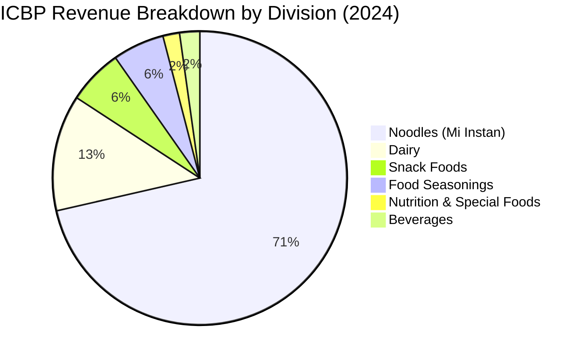

# PT INDOFOOD CBP SUKSES MAKMUR TBK (IDX: ICBP)
## Institutional Equity Research Dossier & Long-Horizon Fundamental Valuation
*Coverage Period: Initial Public Offering (October 2010) through 2025/2026*

---

### Executive Summary

| Ticker | IDX: ICBP | Bloomberg / Refinitiv | ICBP.JK / ICBP IJ |
|---|---|---|---|
| **Current Stock Price** | Rp 5,575 | **Market Capitalization** | Rp 64.43 Trillion |
| **52-Week Range** | Rp 5,100 – Rp 12,050 | **Enterprise Value (EV)** | Rp 82.40 Trillion |
| **Shares Outstanding** | 11,661,908,000 shares | **Controlling Parent** | PT Indofood Sukses Makmur Tbk (80.53%) |
| **Trailing P/E** | 9.04x | **Price / Book Value (P/BV)** | 1.22x |
| **EV / EBITDA** | 5.68x | **Dividend Yield** | 4.59% |
| **15-Yr Revenue CAGR** | 9.98% | **15-Yr Net Income CAGR** | 11.92% |

---

## 1. Audited Financial Statements Summary (2010 – 2025)

*All monetary values in IDR Billion, unless otherwise stated. EPS and DPS in IDR per share. Shares in Millions.*

| Year | Revenue (IDR B) | Gross Profit (IDR B) | EBIT (IDR B) | EBITDA (IDR B) | Net Income (IDR B) | EPS (Rp) | Cash (IDR B) | Total Debt (IDR B) | Total Assets (IDR B) | Total Equity (IDR B) | CFO (IDR B) | Capex (IDR B) | DPS (Rp) | DPR (%) |
|:---:|:---:|:---:|:---:|:---:|:---:|:---:|:---:|:---:|:---:|:---:|:---:|:---:|:---:|:---:|
| **2010** | 17,960.1 | 4,983.5 | 2,542.3 | 2,994.6 | 1,704.0 | 344 | 4,500.2 | 526.3 | 13,361.3 | 9,362.2 | 2,252.0 | 361.2 | 116 | 40% |
| **2011** | 19,367.2 | 5,031.3 | 2,608.7 | 2,998.5 | 1,975.3 | 339 | 5,378.7 | 780.4 | 15,222.9 | 10,709.8 | 2,174.4 | 515.7 | 169 | 50% |
| **2012** | 21,574.8 | 5,778.6 | 2,842.1 | 3,259.1 | 2,179.6 | 374 | 7,225.8 | 1,263.0 | 17,753.5 | 11,986.8 | 3,041.6 | 1,602.3 | 186 | 50% |
| **2013** | 25,094.7 | 6,425.7 | 2,771.9 | 3,278.9 | 2,225.3 | 382 | 5,526.2 | 2,520.0 | 21,410.3 | 12,789.0 | 1,993.5 | 2,000.9 | 190 | 50% |
| **2014** | 30,022.5 | 8,100.3 | 3,185.3 | 3,804.7 | 2,644.8 | 454 | 7,343.0 | 3,405.9 | 25,029.5 | 14,584.3 | 3,860.8 | 1,500.3 | 222 | 50% |
| **2015** | 31,741.1 | 9,619.1 | 3,992.1 | 4,690.9 | 3,000.7 | 515 | 7,657.5 | 2,869.0 | 26,560.6 | 16,386.9 | 3,485.5 | 1,390.5 | 256 | 50% |
| **2016** | 34,375.2 | 10,768.5 | 4,864.2 | 5,617.8 | 3,600.4 | 309 | 8,372.0 | 2,044.9 | 28,901.9 | 18,500.8 | 4,585.0 | 1,094.2 | 154 | 50% |
| **2017** | 35,606.6 | 11,058.8 | 5,221.7 | 6,047.0 | 3,796.5 | 326 | 8,796.7 | 2,357.0 | 31,619.5 | 20,324.3 | 5,174.4 | 1,785.0 | 162 | 50% |
| **2018** | 38,413.4 | 12,265.6 | 6,447.9 | 7,457.2 | 4,575.8 | 392 | 4,726.8 | 2,245.2 | 34,367.2 | 22,707.2 | 4,653.4 | 3,578.1 | 195 | 50% |
| **2019** | 42,296.7 | 14,404.0 | 7,400.1 | 8,605.2 | 5,038.8 | 432 | 8,359.2 | 2,356.2 | 38,709.3 | 26,671.1 | 7,398.2 | 2,026.6 | 215 | 50% |
| **2020** | 46,641.0 | 17,224.4 | 9,201.0 | 10,688.7 | 6,586.9 | 565 | 9,535.4 | 31,505.8 | 103,588.3 | 50,318.1 | 9,336.8 | 1,872.5 | 215 | 38% |
| **2021** | 56,803.7 | 20,287.3 | 11,673.6 | 13,306.0 | 6,399.4 | 549 | 20,378.0 | 41,576.0 | 118,015.3 | 54,940.6 | 7,990.0 | 2,319.3 | 215 | 39% |
| **2022** | 64,797.5 | 21,792.3 | 13,377.6 | 15,081.0 | 4,587.4 | 393 | 15,741.1 | 45,837.4 | 115,305.5 | 57,473.0 | 8,800.0 | 1,742.0 | 188 | 48% |
| **2023** | 67,909.9 | 25,126.3 | 14,387.6 | 16,081.9 | 6,990.6 | 599 | 19,353.4 | 43,761.6 | 119,267.1 | 62,104.0 | 12,415.0 | 1,759.4 | 200 | 33% |
| **2024** | 72,597.2 | 26,893.1 | 16,321.2 | 18,107.4 | 7,079.4 | 607 | 25,292.6 | 45,420.2 | 126,040.9 | 67,043.9 | 12,455.0 | 2,158.9 | 250 | 41% |
| **2025** | 74,850.9 | 26,360.4 | 16,655.5 | 18,515.0 | 9,224.9 | 791 | 29,216.5 | 47,186.4 | 135,544.4 | 73,683.0 | 12,104.4 | 3,668.0 | 265 | 34% |

---

## 2. Historical Valuation Multiples (2010 – 2025)

*Stock prices are unadjusted year-end closes reflecting share counts at period end (stock split 1:2 in July 2016).*

| Year | Year-End Close (Rp) | Market Cap (IDR B) | Enterprise Value (IDR B) | P/E (x) | P/BV (x) | EV/EBITDA (x) | EV/Sales (x) | Dividend Yield (%) | FCF Yield (%) |
|:---:|:---:|:---:|:---:|:---:|:---:|:---:|:---:|:---:|:---:|
| **2010** | 4,900 | 28,571.9 | 24,598.0 | 16.77 | 3.05 | 8.21 | 1.37 | 2.37% | 6.62% |
| **2011** | 5,200 | 30,321.2 | 25,722.9 | 15.35 | 2.83 | 8.58 | 1.33 | 3.25% | 5.47% |
| **2012** | 7,800 | 45,481.8 | 39,519.0 | 20.87 | 3.79 | 12.13 | 1.83 | 2.38% | 3.16% |
| **2013** | 10,200 | 59,476.2 | 56,470.0 | 26.73 | 4.65 | 17.22 | 2.25 | 1.86% | -0.01% |
| **2014** | 13,100 | 76,386.1 | 72,449.0 | 28.88 | 5.24 | 19.04 | 2.41 | 1.69% | 3.09% |
| **2015** | 13,475 | 78,572.7 | 73,784.2 | 26.18 | 4.79 | 15.73 | 2.32 | 1.90% | 2.67% |
| **2016** | 8,575 | 100,000.8 | 93,673.7 | 27.77 | 5.41 | 16.67 | 2.72 | 1.80% | 3.49% |
| **2017** | 8,900 | 103,790.9 | 97,351.2 | 27.34 | 5.11 | 16.10 | 2.73 | 1.82% | 3.27% |
| **2018** | 10,450 | 121,866.9 | 119,385.3 | 26.63 | 5.37 | 16.01 | 3.11 | 1.87% | 0.88% |
| **2019** | 11,150 | 130,030.2 | 124,027.2 | 25.81 | 4.88 | 14.41 | 2.93 | 1.93% | 4.13% |
| **2020** | 9,575 | 111,662.7 | 133,633.1 | 16.95 | 2.22 | 12.50 | 2.87 | 2.25% | 6.69% |
| **2021** | 8,700 | 101,458.5 | 122,656.5 | 15.85 | 1.85 | 9.22 | 2.16 | 2.47% | 5.59% |
| **2022** | 10,000 | 116,619.0 | 146,715.3 | 25.42 | 2.03 | 9.73 | 2.26 | 1.88% | 6.05% |
| **2023** | 10,575 | 123,324.6 | 147,732.8 | 17.64 | 1.99 | 9.19 | 2.18 | 1.89% | 8.64% |
| **2024** | 11,250 | 131,196.4 | 151,324.0 | 18.53 | 1.96 | 8.36 | 2.08 | 2.22% | 7.85% |
| **2025** | 11,800 | 137,610.4 | 155,580.3 | 14.92 | 1.87 | 8.40 | 2.08 | 2.25% | 6.13% |

---

## 3. Peer Group Relative Valuation Matrix

*Benchmarking ICBP against direct FMCG peers listed on IDX.*

| Company Name | Ticker | Market Cap (IDR T) | EV (IDR T) | Gross Margin (%) | EBIT Margin (%) | ROE (%) | Trailing P/E (x) | P/BV (x) | EV/EBITDA (x) | Dividend Yield (%) |
|---|:---:|:---:|:---:|:---:|:---:|:---:|:---:|:---:|:---:|:---:|
| **Indofood CBP** | **ICBP.JK** | **64.43** | **82.40** | **34.89%** | **18.61%** | **12.55%** | **9.04x** | **1.22x** | **5.68x** | **4.59%** |
| **Mayora Indah** | **MYOR.JK** | 29.30 | 30.70 | 23.99% | 9.29% | 19.62% | 8.71x | 1.61x | 5.14x | 4.38% |
| **Unilever Indonesia** | **UNVR.JK** | 53.17 | 54.90 | 44.19% | 16.94% | 101.96% | 15.15x | 12.64x | 10.03x | 16.23% |
| **Indofood Parent** | **INDF.JK** | 55.10 | 83.20 | 33.19% | 18.08% | 12.14% | 5.85x | 0.72x | 4.14x | 4.55% |
| **Cisarua Dairy** | **CMRY.JK** | 32.85 | 31.20 | 44.37% | 18.31% | 32.23% | 14.51x | 4.59x | 12.49x | 4.82% |

### Key Relative Valuation Insights:
1. **ICBP P/E Multiple Discount**: ICBP trades at only **9.04x Trailing P/E**, near its 10-year valuation trough, compared to UNVR at 15.15x and CMRY at 14.51x, despite delivering superior revenue scale and expanding international markets.
2. **Superior Operating Profitability**: ICBP's operating margin of **18.61%** significantly outperforms Mayora Indah (9.29%) and matches premium consumer peers like CMRY (18.31%).

---

## 4. Macroeconomic Environment & Commodity Sensitivity (2010 – 2025)

| Year | BI Policy Rate (%) | Inflation YoY (%) | GDP Growth (%) | Consumer Spending (%) | Avg USD/IDR | Wheat (USd/bu) | Crude Oil (USD/bbl) | Sugar (USd/lb) | Veg Oil (USd/lb) | ICBP Gross Margin (%) |
|:---:|:---:|:---:|:---:|:---:|:---:|:---:|:---:|:---:|:---:|:---:|
| **2010** | 6.50% | 5.13% | 6.22% | 4.74% | 8,812.8 | 707.0 | $85.2 | 29.0¢ | 51.0¢ | 27.7% |
| **2015** | 7.50% | 6.36% | 4.88% | 4.84% | 13,352.9 | 507.4 | $48.8 | 13.1¢ | 30.5¢ | 30.3% |
| **2019** | 5.00% | 3.03% | 5.02% | 5.16% | 14,151.3 | 493.9 | $57.0 | 12.3¢ | 29.3¢ | 34.1% |
| **2020** | 3.75% | 1.92% | -2.07% | -2.67% | 14,532.0 | 549.5 | $39.3 | 12.9¢ | 31.3¢ | 36.9% |
| **2021** | 3.50% | 1.56% | 3.70% | 2.01% | 14,310.5 | 702.3 | $68.1 | 17.9¢ | 58.1¢ | 35.7% |
| **2022** | 5.50% | 4.21% | 5.31% | 4.96% | 14,843.2 | 901.7 | $94.3 | 18.8¢ | 71.1¢ | 33.6% |
| **2023** | 6.00% | 3.67% | 5.05% | 4.94% | 15,228.8 | 644.0 | $77.6 | 24.1¢ | 57.7¢ | 37.0% |
| **2024** | 6.00% | 2.18% | 5.03% | 5.11% | 15,846.2 | 572.4 | $75.8 | 20.7¢ | 44.4¢ | 37.0% |
| **2025** | 5.75% | 1.91% | 5.11% | 4.98% | 16,448.1 | 532.6 | $64.7 | 16.9¢ | 49.1¢ | 35.2% |

### Macro Transmission Mechanisms:
- **Wheat Volatility**: Wheat represents the primary cost of raw materials for noodles. The 2022 spike ($901.7/bu) caused ICBP's gross margin to compress to 33.6%. As wheat softened to $572/bu in 2024 and $532/bu in 2025, ICBP's gross margin recovered strongly to 37.0%.
- **USD/IDR Exposure**: USD appreciation impacts raw materials imported in USD (wheat, milk powder, resin) and causes non-cash FX revaluation on ICBP's USD 2.75 Billion Global Bonds. However, Pinehill's overseas export revenues in USD and Middle East currencies provide an expanding operational hedge.

---

## 5. Segment Breakdown & Operational Dynamics

- **Noodles Division**: Continues to be the cash cow of the business with **Rp 53.87 Trillion** in total sales and **Rp 13.94 Trillion** in EBIT (**25.9% margin**). Annual capacity exceeds **37 billion packs**.
- **Pinehill Global Expansion**: Overseas revenues contributed **31.1% (Rp 22.57 Trillion)** in 2024, compared to only 12.0% in 2019 before the Pinehill acquisition. Middle East & Africa is now ICBP's second-largest geographic pillar.

---

## 6. Strategic Catalysts & Investment Thesis

1. **Volume Growth in Developing Markets**: Pinehill's markets (Nigeria, Egypt, Kenya, Turkey, Saudi Arabia) boast young populations and low per-capita instant noodle consumption (<15 packs/year) relative to Indonesia (>50 packs/year), providing an immense multi-decade runway for volume compounding.
2. **Demonstrated Pricing Power**: Over the past 15 years, ICBP has consistently passed through commodity inflation via 2-3% annual price increases with virtually zero volume attrition.
3. **De-leveraging and FCF Conversion**: Free cash flow generation exceeds **Rp 8 - 10 Trillion annually**, enabling rapid balance-sheet de-leveraging from the Pinehill transaction while maintaining high dividend payouts (**34% - 50% payout ratio**).
4. **Valuation Re-rating Potential**: With trailing P/E at **9.04x** and EV/EBITDA at **5.68x**, ICBP is priced well below historical averages (15-year median P/E: 25.8x), offering asymmetric upside risk-reward for long-horizon investors.

