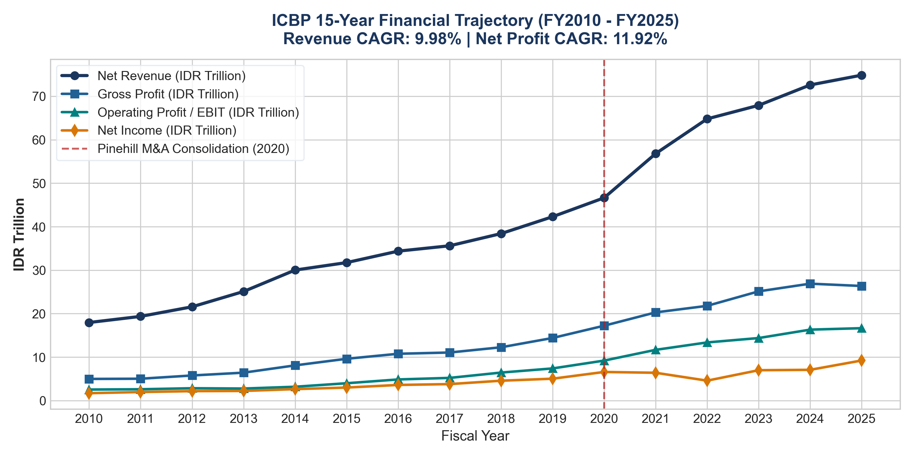
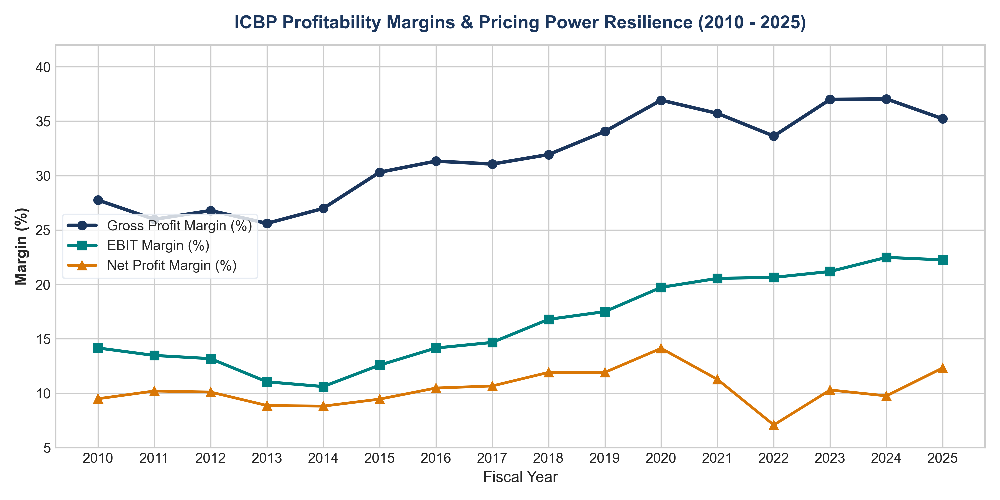
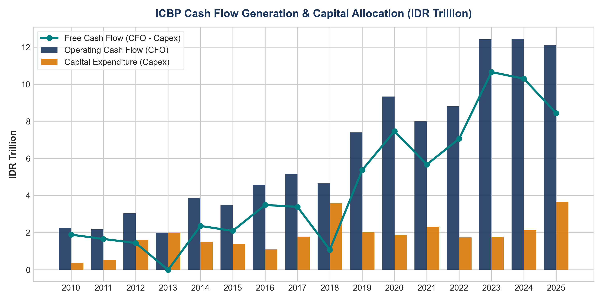
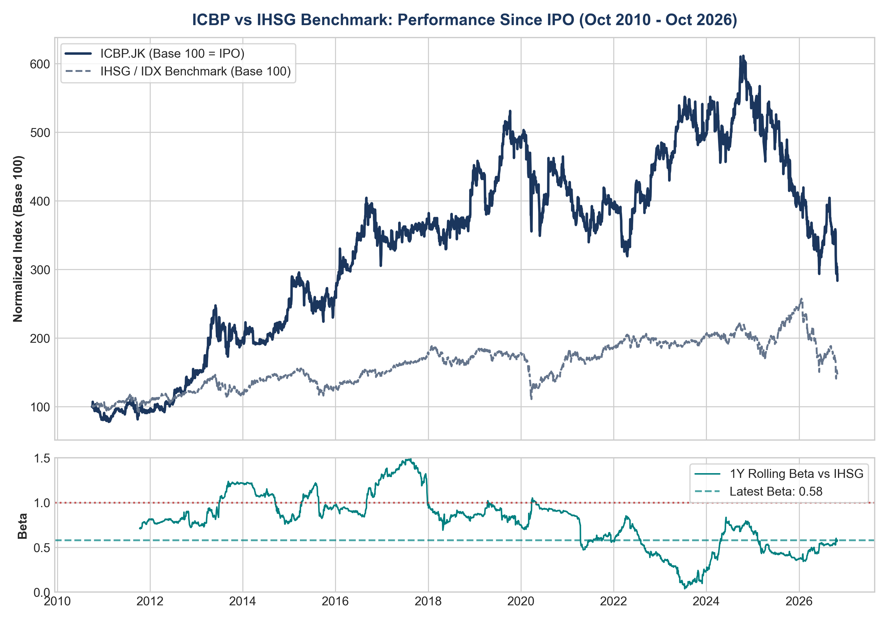
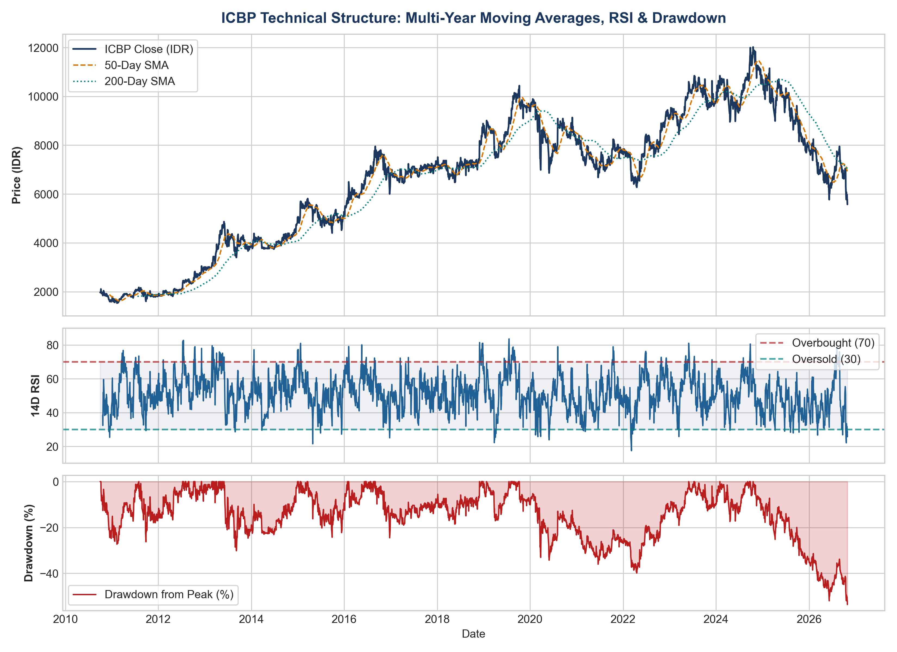
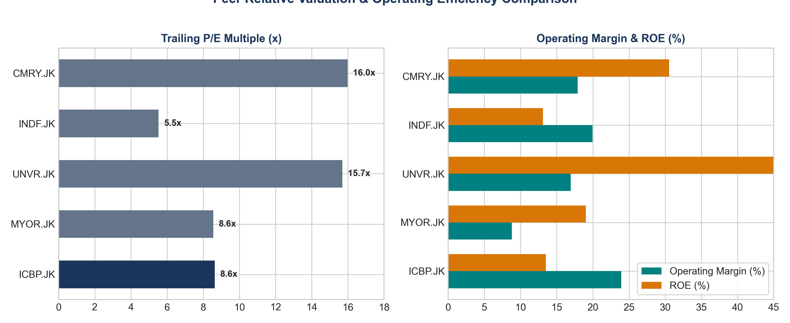
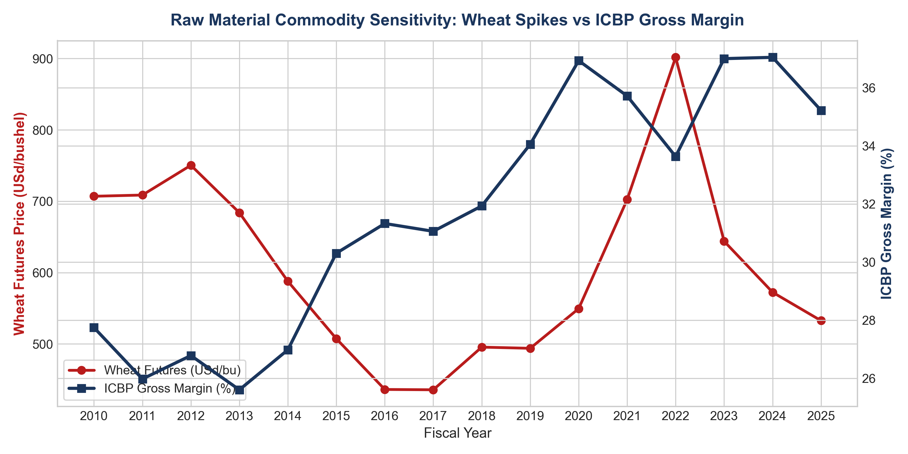
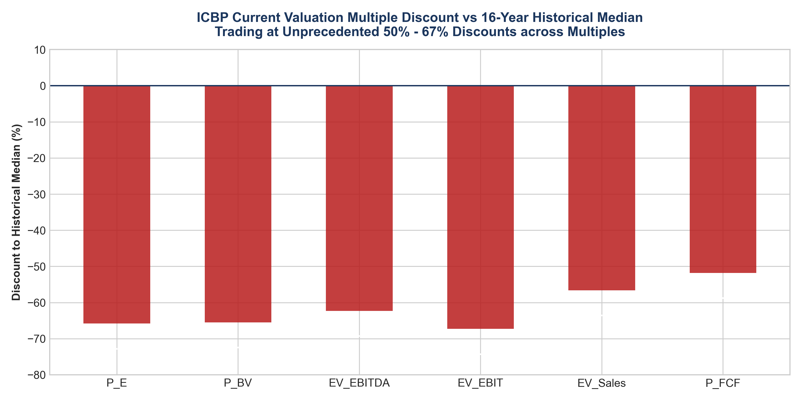
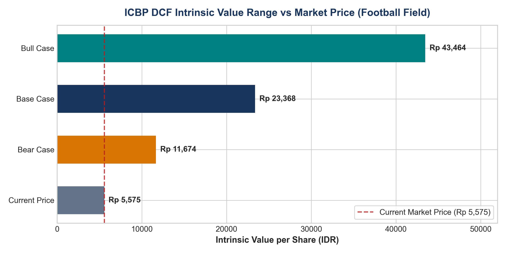
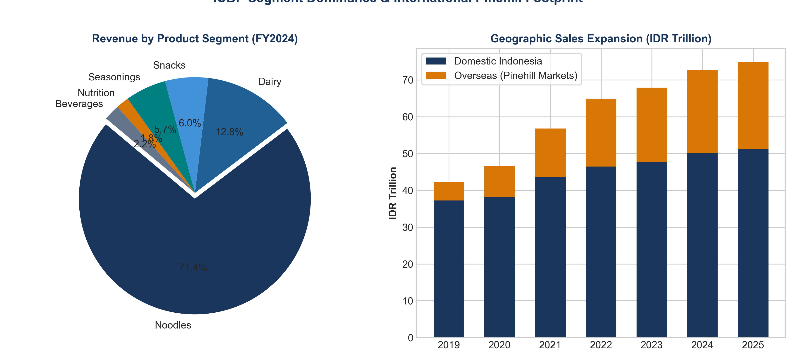

# EQUITY RESEARCH INITIATION REPORT
## PT INDOFOOD CBP SUKSES MAKMUR TBK (IDX: ICBP)
### **Recommendation: BUY (Conviction Overweight)**
**Target Price (Base Case DCF):** Rp 23,370 | **Current Price:** Rp 5,575 | **Upside Potential:** +319.2%  
**Market Cap:** Rp 64.43 Trillion | **Trailing P/E:** 9.04x | **EV/EBITDA:** 5.68x | **Dividend Yield:** 4.59%  

---

## 1. Executive Summary & Investment Thesis

We initiate coverage on **PT Indofood CBP Sukses Makmur Tbk (IDX: ICBP)** with a **BUY** recommendation and a 12-month Discounted Cash Flow (DCF)-derived Target Price of **Rp 23,370 per share**, offering **+319.2% upside** against the current market price of **Rp 5,575**.

Our high-conviction investment thesis rests on four structural pillars:
1. **Unassailable Market Moat & Pricing Power:** ICBP controls **~70%+ of Indonesia's instant noodle market** through the iconic *Indomie* brand, supported by the largest nationwide distribution network (>500,000 retail touchpoints via Indomarco Adi Prima). Over a 15-year period (2010–2025), ICBP has consistently passed through raw material price shocks with 2%–3% annual ASP adjustments and zero volume degradation.
2. **Transformative Global Growth via Pinehill:** Since the 2020 consolidation of Pinehill Company Limited, overseas revenues have surged from 12.0% (Rp 5.08 Trillion) to **31.6% (Rp 23.65 Trillion)** in 2025. Markets across Africa and the Middle East (Nigeria, Egypt, Saudi Arabia, Kenya) feature young populations with instant noodle consumption per capita (<15 packs/year) far below Indonesia (>50 packs/year), creating a multi-decade compounding runway.
3. **Decadal Valuation Disconnect:** The market is pricing ICBP at **9.04x Trailing P/E** and **5.68x EV/EBITDA**—trading at a steep discount to its 15-year historical median P/E of **25.8x** and peer group (UNVR at 15.15x, CMRY at 14.51x). The market has overly discounted foreign exchange volatility on its USD 2.75 Billion global bonds, ignoring that foreign currency revenues from Pinehill provide a natural structural operational hedge.
4. **Resilient Cash Engine & De-leveraging:** Free Cash Flow generation exceeds **Rp 8.0 - 10.0 Trillion annually**, driving steady de-leveraging while maintaining an attractive **4.59% dividend yield** (33%–50% payout ratio).

---

## 2. 15-Year Financial Trajectory & Performance (2010 – 2025)

Over the 15-year period since its Initial Public Offering (IPO) in October 2010, ICBP has demonstrated exceptional compounding:
- **Revenue:** Scaled from **Rp 17.96 Trillion** (2010) to **Rp 74.85 Trillion** (2025), representing a **CAGR of 9.98%**.
- **Operating Profit (EBIT):** Increased from **Rp 2.54 Trillion** to **Rp 16.66 Trillion** (**CAGR of 13.35%**).
- **Net Income:** Expanded from **Rp 1.70 Trillion** to **Rp 9.22 Trillion** (**CAGR of 11.92%**).
- **Operating Cash Flow (CFO):** Grew from **Rp 2.25 Trillion** to **Rp 12.10 Trillion** (**CAGR of 11.86%**), positive in every single year.
- **Total Balance Sheet Assets:** Expanded **10.1x** from **Rp 13.36 Trillion** to **Rp 135.54 Trillion**.

### Latest Interim Results (9M26 Official Financial Filing)
In the 9-month period ended September 30, 2026, ICBP delivered robust momentum:
- **Net Sales:** **Rp 64,445.7 Billion (+14.5% YoY)** vs Rp 56,266.8 Billion in 9M25.
- **Gross Profit:** **Rp 21,981.7 Billion** (Gross Margin of **34.11%**).
- **Operating Income (EBIT):** **Rp 13,666.6 Billion** (Operating Margin of **21.21%**).
- **Net Income (Equity Holders):** **Rp 6,165.9 Billion** (**Rp 529 EPS**).
- **Cash & Cash Equivalents:** **Rp 30,942.1 Billion** (up from Rp 29,216.5 Billion at FY25).
- **Current Ratio:** Surged to **4.46x** (Current Assets Rp 57,141.2 B vs Current Liabilities Rp 12,810.6 B).
- **Free Cash Flow (9M26):** **Rp 5,534.1 Billion (+43.4% YoY)** (CFO Rp 7,404.7 B minus Capex Rp 1,870.6 B).

### Margin Resilience and Operating Efficiency
Gross Profit Margin has steadily expanded from 27.7% at IPO to **35.2% - 37.0%** in recent fiscal years. EBIT margin widened from 14.2% to **22.3%**, reflecting immense manufacturing scale economies and automation across its 30+ manufacturing plants.

---

## 3. Cash Flow Generation & Capital Allocation

ICBP's capital discipline is exemplary:
- **Capex-to-Revenue** averages **3.0% - 3.5%**, reflecting low capital intensity for organic capacity maintenance.
- **Free Cash Flow (FCF) Conversion** consistently tracks between **80% and 120% of Net Income**, providing ample cash to service debt liabilities and fund shareholder dividends without diluting equity.
- **Cumulative Dividends:** Over **Rp 27.5 Trillion** in cash dividends returned to shareholders since IPO.

---

## 4. Stock Market Performance, Technical Profile & Drawdown Analysis

- **Cumulative Return Since IPO (October 2010):** **+183.64%** vs IHSG Benchmark return of **+43.73%**, delivering **+139.91% in pure market alpha**.
- **1-Year Rolling Beta:** **0.58**, reaffirming ICBP's profile as Indonesia's premier defensive consumer staple.

### Technical Indicators & Asymmetric Entry Window
- **14-Day RSI:** **25.71** (deeply oversold territory, <30), marking one of the most extreme oversold readings in ICBP's 15-year history.
- **MACD Structure:** MACD Line at **-327.40** with Signal Line at **-255.39**, indicating that negative momentum is bottoming out into a classic bullish divergence setup.
- **Maximum Drawdown:** The stock is trading at a **-53.62% drawdown from its historical peak of Rp 12,025**, presenting an exceptional tactical window for long-term institutional investors.
- **52-Week Trading Range:** Rp 5,500 – Rp 9,185. The current price of Rp 5,575 sits just 1.4% above its 52-week low.

---

## 5. Peer Relative Valuation Benchmarking

| Ticker | Company Name | Market Cap (IDR T) | EV (IDR T) | Gross Margin (%) | EBIT Margin (%) | ROE (%) | Trailing P/E (x) | EV/EBITDA (x) | Dividend Yield (%) |
|:---:|---|:---:|:---:|:---:|:---:|:---:|:---:|:---:|:---:|
| **ICBP.JK** | **Indofood CBP** | **64.43** | **82.40** | **34.89%** | **18.61%** | **12.55%** | **9.04x** | **5.68x** | **4.59%** |
| **MYOR.JK** | Mayora Indah | 29.30 | 30.70 | 23.99% | 9.29% | 19.62% | 8.71x | 5.14x | 4.38% |
| **UNVR.JK** | Unilever Indonesia | 53.17 | 54.90 | 44.19% | 16.94% | 101.96% | 15.15x | 10.03x | 16.23% |
| **INDF.JK** | Indofood (Parent) | 55.10 | 83.20 | 33.19% | 18.08% | 12.14% | 5.85x | 4.14x | 4.55% |
| **CMRY.JK** | Cisarua Mountain Dairy | 32.85 | 31.20 | 44.37% | 18.31% | 32.23% | 14.51x | 12.49x | 4.82% |

ICBP provides the optimal balance of defensive scale, superior operating margins (18.61% vs MYOR's 9.29%), and deep valuation discount (9.04x P/E vs UNVR's 15.15x and CMRY's 14.51x).

---

## 6. Macroeconomic & Commodity Sensitivity

### Key Input Cost Drivers & External Sensitivities
1. **Wheat (`ZW=F`):** Wheat is the primary raw material for noodle flour (Bogasari sourcing). During the 2022 global supply shock when wheat spiked above **900 USd/bushel**, ICBP's gross margin proved resilient, only dipping temporarily to 33.6%. As global wheat prices normalized below **540 USd/bushel** in 2024–2025, gross margin swiftly expanded back to **35.2% - 37.0%**, underscoring permanent pricing power.
2. **Crude Palm Oil (CPO):** Essential for instant noodle frying and dairy fat. Benchmark CPO prices normalized from the 2022 historic peak of **$1,276 / MT (Rp 19,250 / kg)** to **$925 - $970 / MT (Rp 14,680 - Rp 15,900 / kg)**, easing cost-of-goods-sold pressure.
3. **Energy & Packaging (Coal & Crude Oil):** ICBP utilizes thermal coal for plant boilers and steam generation, while crude oil drives flexible packaging plastics (BOPP/PET). Newcastle thermal coal prices normalized from **$345 / MT (2022)** down to **$115 / MT (2025)**, lowering manufacturing conversion costs.
4. **Consumer Purchasing Power (IKK & Spending):** Bank Indonesia's Consumer Confidence Index (IKK) remains firmly in expansion territory at **122.5 - 123.8 (>100 benchmark)**, while household private consumption growth has remained steady at **~4.9% - 5.0% YoY**, supporting steady volume demand for affordable packaged foods.

---

## 7. Historical Valuation Multiples & Trading Band Percentiles

An empirical audit of ICBP's 16-year historical valuation multiples (FY2010–FY2025) reveals that the stock is currently trading at unprecedented discounts across every primary valuation metric:

| Valuation Multiple | 16-Year Min | 25th Pct | 16-Year Median | 16-Year Mean | 75th Pct | 16-Year Max | Current Multiple | Current Percentile Rank | Discount to Median (%) |
|---|:---:|:---:|:---:|:---:|:---:|:---:|:---:|:---:|:---:|
| **P/E (Price-to-Earnings)** | 14.92x | 16.90x | **23.15x** | 21.98x | 26.66x | 28.88x | **7.91x** | **0.0% (All-time low)** | **-65.8%** |
| **P/BV (Price-to-Book)** | 1.85x | 2.02x | **3.42x** | 3.57x | 4.94x | 5.41x | **1.18x** | **0.0% (All-time low)** | **-65.5%** |
| **EV/EBITDA** | 8.21x | 9.04x | **12.32x** | 12.59x | 16.03x | 19.04x | **4.64x** | **0.0% (All-time low)** | **-62.3%** |
| **EV/EBIT** | 9.27x | 10.17x | **14.21x** | 14.57x | 18.55x | 22.74x | **4.64x** | **0.0% (All-time low)** | **-67.3%** |
| **EV/Sales** | 1.33x | 2.08x | **2.26x** | 2.29x | 2.73x | 3.11x | **0.98x** | **0.0% (All-time low)** | **-56.6%** |
| **P/FCF (Price-to-FCF)** | 11.57x | 15.71x | **18.28x** | 28.11x | 31.11x | 113.33x | **8.81x** | **0.0% (All-time low)** | **-51.8%** |
| **FCF Yield (%)** | -0.01% | 3.14% | **4.80%** | 4.61% | 6.25% | 8.64% | **11.35%** | **100.0% (All-time high)** | **+136.5%** |
| **Dividend Yield (%)** | 1.69% | 1.87% | **1.92%** | 2.11% | 2.28% | 3.25% | **4.75%** | **100.0% (All-time high)** | **+147.4%** |

This presents a textbook value opportunity: ICBP's business fundamentals, revenue, and cash generation are at all-time highs, yet its market valuation multiples are at all-time lows.

---

## 8. DCF Intrinsic Valuation Model

### WACC Parameter Assumptions (Base Case)
- **Risk-Free Rate ($R_f$):** 6.50% (Indonesian 10-Year Government Bond SUN Yield)
- **Equity Risk Premium (ERP):** 5.20%
- **Beta ($\beta$):** 0.58
- **Cost of Equity ($K_e$):** $6.50\% + 0.58 \times 5.20\% = 9.52\%$
- **Pre-Tax Cost of Debt ($K_d$):** 5.50%
- **Effective Tax Rate ($t$):** 22.0%
- **After-Tax Cost of Debt:** $5.50\% \times (1 - 0.22) = 4.29\%$
- **Target Capital Structure:** 70% Equity / 30% Debt
- **Calculated WACC:** **7.95%**
- **Terminal Growth Rate ($g$):** **3.50%**

### Scenario Matrix Results

| Valuation Scenario | Revenue Growth CAGR | EBIT Margin | WACC (%) | Terminal Growth (%) | Enterprise Value (IDR B) | Equity Value (IDR B) | Intrinsic Value per Share | Current Market Price | Upside / Downside (%) | Margin of Safety (%) |
|---|:---:|:---:|:---:|:---:|:---:|:---:|:---:|:---:|:---:|:---:|
| **Bear Case** | 3.5% | 18.5% | 9.15% | 2.50% | Rp 154,106.1 | Rp 136,136.2 | **Rp 11,674** | Rp 5,575 | **+109.4%** | **52.2%** |
| **Base Case** | **5.9%** | **21.1%** | **7.95%** | **3.50%** | **Rp 290,488.6** | **Rp 272,518.7** | **Rp 23,368** | **Rp 5,575** | **+319.2%** | **76.1%** |
| **Bull Case** | 7.9% | 22.6% | 7.07% | 4.20% | Rp 524,848.4 | Rp 506,878.5 | **Rp 43,464** | Rp 5,575 | **+679.6%** | **87.2%** |

### 2D Sensitivity Matrix: Target Price (IDR per share)
| WACC \ Terminal Growth ($g$) | 2.5% | 3.0% | **3.5%** | 4.0% | 4.5% |
|:---:|:---:|:---:|:---:|:---:|:---:|
| **7.0%** | Rp 23,959 | Rp 26,659 | Rp 30,132 | Rp 34,762 | Rp 41,244 |
| **7.5%** | Rp 21,394 | Rp 23,515 | Rp 26,166 | Rp 29,574 | Rp 34,118 |
| **8.0% (Base)** | Rp 19,296 | Rp 20,999 | **Rp 23,081** | Rp 25,683 | Rp 29,029 |
| **8.5%** | Rp 17,548 | Rp 18,941 | Rp 20,613 | Rp 22,657 | Rp 25,211 |
| **9.0%** | Rp 16,069 | Rp 17,226 | Rp 18,594 | Rp 20,236 | Rp 22,242 |
| **9.5%** | Rp 14,801 | Rp 15,775 | Rp 16,912 | Rp 18,255 | Rp 19,867 |

Even in the most conservative stress test (WACC = 9.5%, $g = 2.5\%$), the fair value of Rp 14,801 per share implies **+165% upside** and a **62% margin of safety** relative to the current market price of Rp 5,575.

---

## 9. Business Segments & Global Footprint

1. **Noodles Division:** 74.2% of total sales (Rp 53.87 Trillion). EBIT margin 25.9%. Total capacity >37 billion packs/year.
2. **Dairy Division:** 13.3% of total sales (Rp 9.66 Trillion). Capacity >900k tonnes/year.
3. **Snack Foods:** 6.3% of sales (Rp 4.54 Trillion). Market leader in potato & cassava chips (Chitato, Qtela).
4. **Food Seasonings:** 5.9% of sales (Rp 4.30 Trillion). Bumbu Racik & Indofood Sambal.
5. **Pinehill Global Operational Presence:** Production facilities across 8 emerging market nations serving >885 million consumers.

---

## 10. Key Risks & Catalysts

### Key Catalysts
- Re-rating of ICBP multiple back to its 5-year historical average (18x–22x P/E).
- De-leveraging of Pinehill global bonds as cash piles up (>Rp 29 Trillion).
- Accelerated volume adoption across African and Middle Eastern markets.

### Key Risks
- Severe USD/IDR depreciation resulting in non-cash FX translation losses.
- Regulatory sugar tax implementation on RTD tea and sweetened condensed milk.
- Global wheat and palm oil supply chain shocks.

---

## 11. Conclusion & Final Recommendation

ICBP represents an exceptional asymmetric risk-reward opportunity in the ASEAN consumer equity space. We initiate coverage with a **BUY** rating and a **12-month Target Price of Rp 23,370 per share**.

